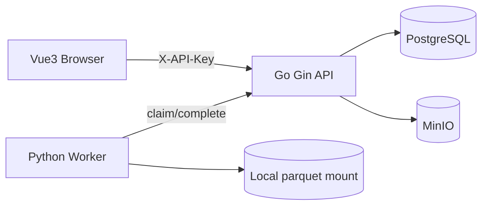

# RobotDataHub Architecture (MVP)

## Data layout

- `datasets`: logical data collections and aggregate statistics.
- `episodes`: ordered slices `(from_index, to_index)`; slices are exclusive at the end and are not assumed to map one-to-one onto files.
- `jobs`: database-backed queue; workers atomically claim using `FOR UPDATE SKIP LOCKED`.

## MVP limitations

- Development-only static API token instead of JWT/RBAC; do not expose publicly.
- Worker reads `sample-data/<dataset-id>/data.parquet` through local volume and **does not yet retrieve raw datasets from MinIO**. This is a partial integration, not the final requested file-to-worker flow.
- Worker has heartbeat timeout recovery but no active heartbeat; long-running jobs can be reclaimed before they complete. Set an appropriate lease/heartbeat before production use.
- Errors are marked failed immediately; retry policy is scaffolded in the database but automatic retries are not yet implemented.
- Import is a simple application-generated manifest schema, not a native LeRobot metadata importer; LeRobot v3 layouts and video/frame synchronization are follow-up work.
- No action/state curve UI or general Parquet browser yet.
- File upload is 1 GiB max at API layer. Consider streaming upload directly to object storage with content checks for large data.
- Signed URLs generated with the internal Docker MinIO hostname may be inaccessible in the browser. Configure a public-facing endpoint/proxy for video playback.
- Secrets in compose examples are local-only; replace before shared deployment.
